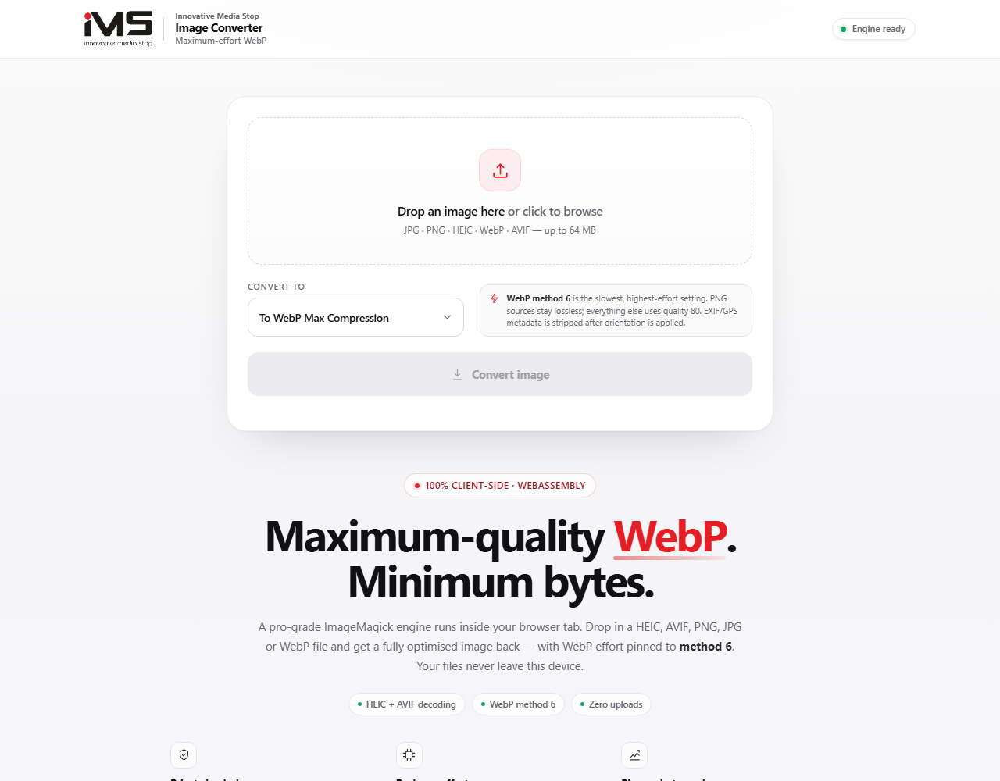
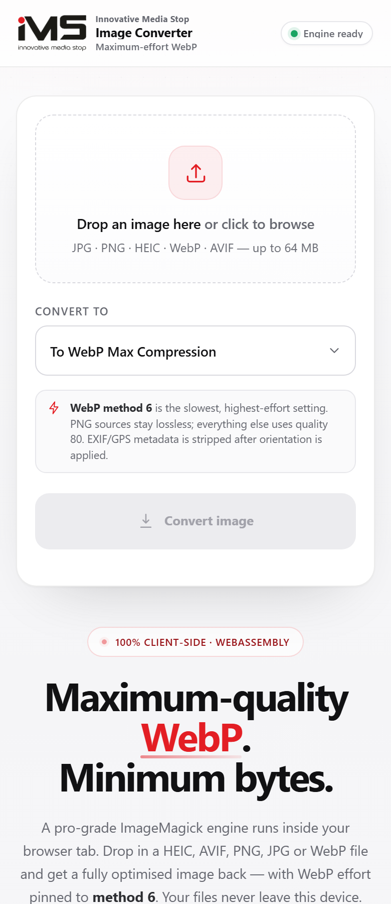

# IMS Image Converter

A completely static, serverless image converter that runs 100% in the browser.
It decodes **JPG, PNG, HEIC/HEIF, WebP and AVIF** and writes **WebP, JPG or PNG**
using WebAssembly — no uploads, no Node.js server, no native `<canvas>` encoder.

Built for [Cloudflare Pages](https://pages.cloudflare.com/), but any static host
works.


## Highlights

- **WebP at maximum effort.** Every WebP is encoded with libwebp pinned to
  `method = 6`, the slowest and best compression mode — the direct equivalent of
  ImageMagick's `-define webp:method=6`. A `<canvas>` conversion cannot set this.
- **PNG → WebP is truly lossless**, including RGB values underneath transparent
  pixels, using libwebp's lossless mode at maximum effort.
- **HEIC and AVIF decode in Wasm.** ImageMagick's WebAssembly build includes
  HEIC/HEIF (libheif/libde265) and AVIF decoding, so iPhone photos work without a
  server or a native codec.
- **Off the main thread.** A dedicated module worker owns the Wasm engines, so
  multi-second encodes never freeze the UI.
- **Private by design.** Images are read with the File API, processed in the
  worker, and turned into a local Blob. Nothing is uploaded. EXIF/GPS metadata is
  stripped after orientation is baked in.
- **Fast repeat visits.** The 15.5 MB Wasm binary is hashed, cached immutably and
  reused for every subsequent conversion. The first visit compiles it once; the
  header shows download and compile progress.

## Screenshots

Desktop and mobile layouts, captured from the live Cloudflare Pages deployment.

| Desktop | Mobile |
| :---: | :---: |
|  |  |

## Conversion rules

| Output | Source | Encoder settings |
| --- | --- | --- |
| **WebP** | PNG | libwebp (Squoosh codec): lossless `1`, `method 6`, `near_lossless 100`, `exact 1`, quality `90` (effort hint) |
| **WebP** | JPG / HEIC / AVIF / WebP | ImageMagick WebP writer: quality `80`, `webp:method=6`, `alpha-quality=100` |
| **JPG** | any | quality `86`, progressive, optimized Huffman tables, 4:2:0, transparency flattened onto white |
| **PNG** | any | zlib level `9`, adaptive filtering, lossless |

Orientation is applied before metadata is removed, so portrait phone photos stay
upright even with EXIF stripped.

### Why two Wasm codecs?

`magick-wasm` is the core engine: it handles every input format (including HEIC),
lossy WebP via `webp:method=6`, and the JPG/PNG writers. For PNG → WebP lossless
we use libwebp through
[`@jsquash/webp`](https://github.com/jamsinclair/jSquash) — the Squoosh WebP
codec repackaged for browsers.

That second path is intentional. ImageMagick's own WebP writer maps its `quality`
setting to libwebp's *near-lossless preprocessing*. At `quality=100` it is
pixel-exact, but `method=6` then takes a pathological amount of CPU (tens of
seconds per megapixel). libwebp exposes `near_lossless` separately, so we can
keep lossless output pixel-exact while using an efficient effort level. The
result is the same libwebp bitstream, much faster.

## Architecture

```
┌──────────────────────────── main thread ────────────────────────────┐
│  index.html + src/main.js          drag/drop, format select, stats  │
│  src/style.css                     UI, states, result panel         │
└───────────────────────────────┬─────────────────────────────────────┘
                                │ postMessage (ArrayBuffer transfer)
┌───────────────────────────────▼─────────────────────────────────────┐
│  src/converter.worker.js                                            │
│   1. fetch magick.wasm with progress → initialize ImageMagick       │
│   2. decode + auto-orient + strip metadata                          │
│   3a. JPG/PNG → ImageMagick writer                                  │
│   3b. other → WebP → ImageMagick writer, `webp:method=6`            │
│   3c. PNG → WebP → raw RGBA → libwebp lossless, `method: 6`         │
│   4. transfer the encoded ArrayBuffer back                          │
└─────────────────────────────────────────────────────────────────────┘
```

`src/lib/convert.js` contains the actual encode rules and has no DOM/worker
dependencies, which is why it can also run in Node for the smoke test.

## Project structure

```
ims-image-converter/
├─ index.html
├─ package.json
├─ package-lock.json
├─ .nvmrc                      # Node 22
├─ vite.config.js
├─ README.md
├─ docs/
│  ├─ screenshot-desktop.png
│  └─ screenshot-mobile.png
├─ public/
│  ├─ _headers                 # Cloudflare Pages caching + security headers
│  ├─ favicon.svg
│  ├─ ims-header.png           # header logo (provided asset)
│  ├─ ims-footer.png           # footer logo (provided asset)
│  └─ robots.txt
├─ scripts/
│  └─ smoke-test.mjs           # Node verification of codec rules
└─ src/
   ├─ main.js                  # UI / worker orchestration
   ├─ converter.worker.js      # Wasm engine + job protocol
   ├─ style.css
   └─ lib/
      ├─ convert.js            # ImageMagick + libwebp settings
      └─ formats.js            # formats, MIME types, validation, helpers
```

## Run locally

Requires Node.js 20.19+.

```bash
npm install
npm run dev          # http://localhost:5173
```

Production build and preview:

```bash
npm run build        # emits dist/
npm run preview      # http://localhost:4173
```

Verify the codec rules without a browser:

```bash
npm run smoke
```

The smoke test encodes synthetic PNG/JPG inputs and asserts that PNG → WebP is
VP8L and pixel-exact, while other sources produce lossy VP8.

## Deploy to Cloudflare Pages

### Git integration (recommended)

1. Push the project to GitHub/GitLab.
2. In the Cloudflare dashboard, create a Pages project from the repo.
3. Build command: `npm run build`
4. Build output directory: `dist`
5. Deploy. `public/_headers` is copied into `dist` and applied automatically.

### Wrangler CLI

```bash
npm run build
npx wrangler pages deploy dist --project-name ims-image-converter
```

Change the `--project-name` value (or the `deploy` script) to your own Pages
project. If you serve the app from a sub-path instead of the domain root, set
`base` in `vite.config.js` first.

The `_headers` file marks `/assets/*` — including both Wasm binaries — as
immutable for a year. Cloudflare compresses the 15.5 MB ImageMagick binary to
roughly 5.5 MB over the wire.

The repo includes `.nvmrc` (Node 22). If your Pages project uses an older
default, set `NODE_VERSION=22` in the build environment variables.

## Browser support

- Chrome / Edge 90+
- Firefox 90+
- Safari 15+
- Any browser with ES module workers and WebAssembly

The libwebp codec ships a SIMD build and a non-SIMD fallback, selected at
runtime. No cross-origin isolation (`COOP`/`COEP`) headers are required.

## Limits and notes

- **64 MB per file** (enforced in the UI). Truly enormous images can exceed
  WebAssembly's 32-bit memory; the UI reports memory errors gracefully.
- **HEIC sequences** are decoded as their first frame. Animated WebP/AVIF are not
  a target of this tool; inputs are single images.
- **Max-effort lossless WebP is slow on large PNGs** by nature. The Wasm engine
  runs in a worker, so the page stays responsive; progress text explains what is
  happening.
- **Metadata is stripped** after EXIF orientation is applied. This shrinks files
  and avoids leaking GPS data. Embedded ICC profiles are dropped as well; if you
  need colour-managed archival output, keep the original file.
- Output can legitimately be **larger** than the input (for example AVIF → WebP
  at quality 80, or HEIC → PNG). The result panel shows the real change, not an
  invented saving.
- The UI converts one image at a time. Batch conversion would be a natural next
  step but is outside the current scope.

## Customising

- Quality constants live at the top of `src/lib/convert.js`
  (`WEBP_LOSSY_QUALITY`, `WEBP_MAX_METHOD`, `WEBP_LOSSLESS_QUALITY`,
  `JPEG_QUALITY`, `PNG_COMPRESSION_LEVEL`).
- Format labels, MIME types and extensions are in `src/lib/formats.js`; the
  dropdown is generated from that list.
- Replace `public/ims-header.png` and `public/ims-footer.png` with updated brand
  artwork at any time — keep the same filenames or update the two `` tags in
  `index.html`.
- Brand colour tokens (`--brand`, `--ink`, …) are at the top of `src/style.css`.

## Privacy

There is no backend and no analytics. The only network requests are for the
same-origin Wasm/JS assets that make up the app. The selected image is read with
`File.arrayBuffer()`, transferred into the worker, and never sent anywhere.

## Licences

- [ImageMagick](https://imagemagick.org/) / [`@imagemagick/magick-wasm`](https://github.com/dlemstra/magick-wasm) — Apache-2.0 (ImageMagick licence).
- [libwebp](https://chromium.googlesource.com/webm/libwebp) and
  [jSquash](https://github.com/jamsinclair/jSquash) (Squoosh codecs) — Apache-2.0 / BSD-style.
- IMS logos are property of Innovative Media Stop.
